# Koda: Baby Tracker – User Manual
**Version:** 1.0  
**App Build:** 2.1  
**Team Name:** Team Bedrock (Team 8)  
**Date:** 10/09/2026 

---

## 1. Introduction
Koda is an intuitive, multi-user mobile application designed to help parents and caregivers record and analyze an infant's daily activities which can include feedings, sleep schedules, diaper changes, and mood updates. Built with offline-first capabilities and Tamagotchi-inspired virtual animal avatars, Koda simplifies multi-caregiver coordination while generating AI-driven behavioral insights and HIPAA-compliant PDF summaries for healthcare professionals.

---

## 2. System Requirements
- **Hardware:** 
  - Mobile or desktop device (iOS, Android, macOS, or Windows)
  - Minimum 2GB RAM
  - Touchscreen recommended for mobile navigation (supports tap and swipe gestures)
- **Software:** 
  - Modern web browser (Google Chrome, Apple Safari, or Microsoft Edge)
  - iOS 14.0+ or Android 10.0+ (if installed as a Progressive Web App)
- **Other Dependencies:** 
  - Internet connection required for initial sign-up, syncing across multi-user caregiver devices, and exporting PDF health reports. Note that all  core activity logging works entirely offline. 

---

## 3. Installation Guide
* **Web & Mobile Progressive Web App (PWA):** No traditional installation required.
  1. Access the application directly via your browser at `https://koda-app-8f5h.onrender.com`.
  2. *(Optional for Mobile)* Tap your browser's **Share** or **Menu** button and select **"Add to Home Screen"** to install Koda as a native-feeling app on iOS or Android smartphones.

---

## 4. Getting Started
1. **Launching the App:** Open your web browser or tap the **Koda** icon on your device's home screen.
2. **Select Account Type:** On the welcome screen, choose whether you are joining as a **Parent** (Primary Admin) or a **Caregiver**.
3. **Account Creation:**
   - **Parents:** Enter your name, email, and password. Next, create your child's profile by selecting a virtual animal character/avatar, assigning a habitat background, and entering your child's name and date of birth.
   - **Caregivers:** Enter your name, email, and password. Once logged in, navigate toward the settings and open up the linking to parent account. Enter the unique invite code provided by the primary parent to link directly to the child's account. Wait for approval. 
4. **First Navigation:** Once signed in, you will be directed to the main **Habitat Dashboard**, displaying your child's live status animation and current daily activity summaries.

---

## 5. Features & Functions

### Feature 1: Parent & Caregiver Onboarding & Profile Management
**Description:**  
Koda provides distinct registration pathways for Primary Parents (Account Admins) and Secondary Caregivers (nannies, babysitters, or extended family). During setup, parents select a customized virtual animal avatar and assigned habitat background, enter their infant's details (Name and Date of Birth), and can configure or manage profile access for multiple children independently. Caregivers register via email and link directly to a child's profile using an invite code generated by the parent.

**How to Use:**
1. **Parent Registration:** Open Koda, select **Parent**, enter your email/password, select an animal avatar/habitat for your infant, and input your child's Name and Date of Birth.
2. **Multi-Child Switching:** Tap the child drop-down menu on the top global header to switch between existing child profiles or go to settings to create a new child.
3. **Caregiver Setup & Linking:** Caregivers select **Caregiver** on the welcome screen, enter their details and complete registration. In settings, they must enter the invite code from the parent to gain access for the assigned child.

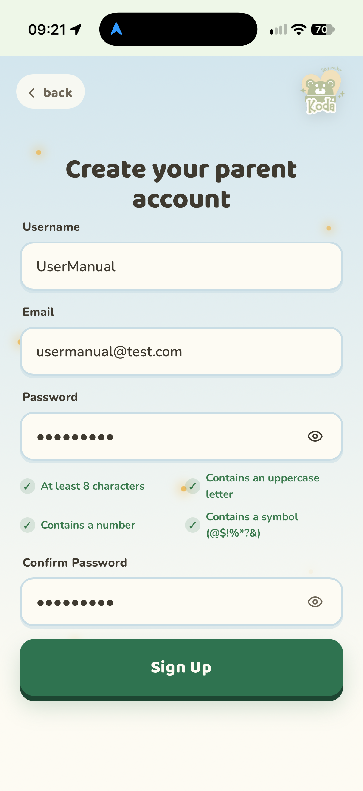

*Figure 1.1: Parent account creation screen.*

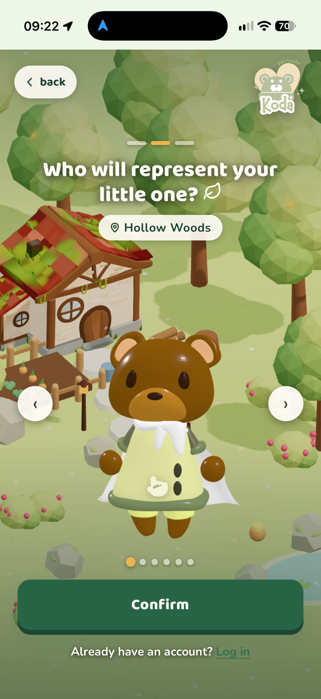

*Figure 1.2: Choosing a virtual animal avatar for a child's profile.*

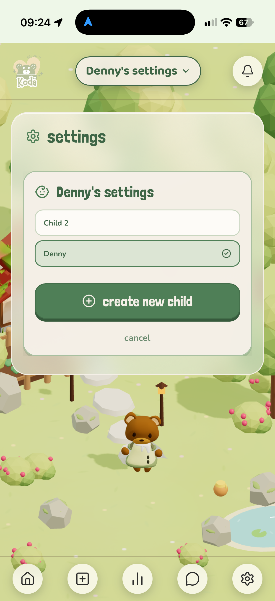

*Figure 1.3: Adding a child profile to the parent account.*

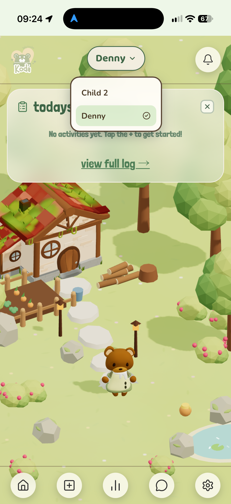

*Figure 1.4: Global header menu allowing parents to switch between multiple child profiles.*

---

### Feature 2: Core Activity Logging with Dark Mode
**Description:**  
Allows parents and caregivers to log core daily activities including feedings (bottle ounces, breast side, or solids), sleep duration (start/end times and crib/car location), diaper changes (wet, solid, or mixed), and mood updates. Successfully logged entries instantly update the home page **"Today's Activities"** dashboard panel and sync to the analytics page. A dedicated Dark Mode theme is built into the main logging pages to prevent screen glare during nighttime feedings and bedtimes.

**How to Use:**
1. From the **Habitat Dashboard**, tap the **+ (Log)** icon on the bottom navigation bar.
2. Choose the activity category: **Feeding**, **Sleeping**, **Diaper Change**, **Mood**, or **Playtime**.
3. Fill in the specific event parameters (e.g., feeding amount in oz, diaper type, or sleep start/end times).
4. *(Optional)* Toggle **Dark Mode** on the top header for nighttime data entry.
5. Tap **Save Entry** The activity immediately appears under the **"Today's Activities"** card on your dashboard.

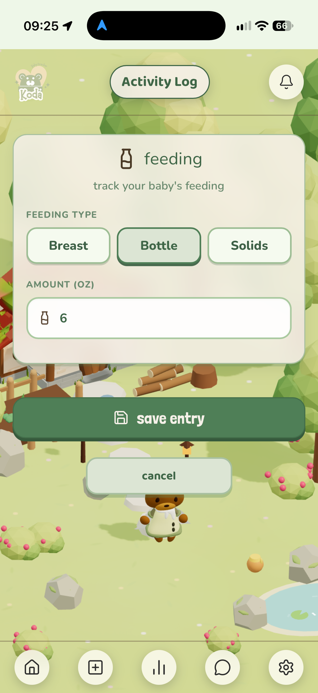

*Figure 2.1: Activity logging form for recording bottle feeding.*

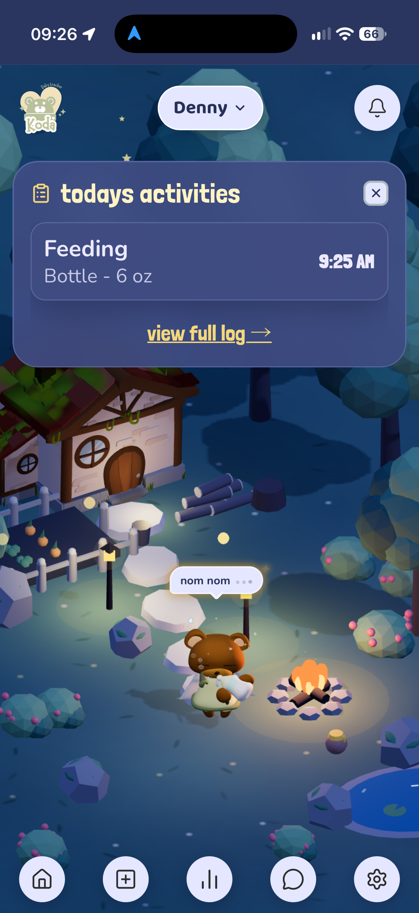

*Figure 2.2: Activity logging screen rendered in Dark Mode for nighttime use.*

---

### Feature 3: Real-Time Duplicate Entry Detection
**Description:**  
To prevent redundant activity logs when multiple caregivers are managing the same child, Koda automatically evaluates incoming logs against database records. If an entry matches an existing record for the same child ID and activity type within a 15-minute window, Koda triggers an overlay confirmation pop-up displaying the original entry details (User and Timestamp) before committing the save.

**How to Use:**
1. Submit an activity log via the **+ (Log)** menu.
2. If another caregiver logged an identical activity within the last 15 minutes, a **"Duplicate Entry Detected"** pop-up modal will pause submission.
3. Review the displayed entry details (showing who submitted the previous entry and at what time).
4. Tap **Keep** to save the entry anyway, or tap **Cancel Log** to cancel the submission and maintain clean data.

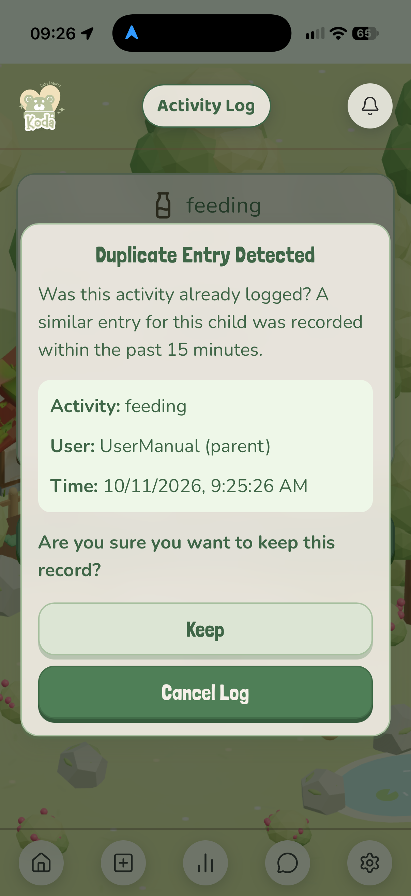

*Figure 3.1: Duplicate-entry detection screen shown when a similar activity has already been logged.*

*Figure 3.2: Activity logging form used before the duplicate check was presented.*

---

### Feature 4: Offline-First Synchronization & Conflict Resolution
**Description:**  
Designed to function seamlessly without Wi-Fi or cellular service. Any activity logged while offline is securely stored in local device memory. Once an active internet connection is detected, the standalone **Sync Manager** automatically uploads local records, resolves conflicting entries across linked accounts using a last-write-wins protocol, and updates the cloud database without losing data.

**How to Use:**
1. Continue logging feedings, sleep, or diaper changes as normal when your device is offline or in low-coverage areas
2. Entries save instantly to local storage and display a local pending indicator.
3. When your device reconnects to Wi-Fi or mobile data, the background **Sync Manager** automatically syncs pending logs with the server and updates all linked caregiver accounts.

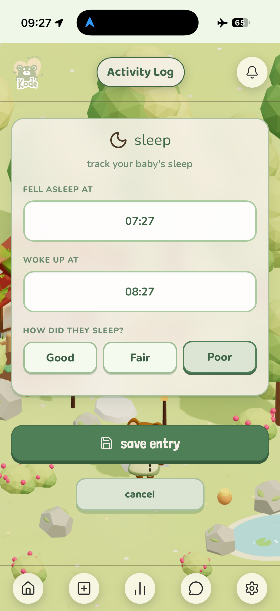

*Figure 4.1: Activity entry logged while the device is offline (notice the airplane mode icon in the topright corner), stored safely in local memory.*

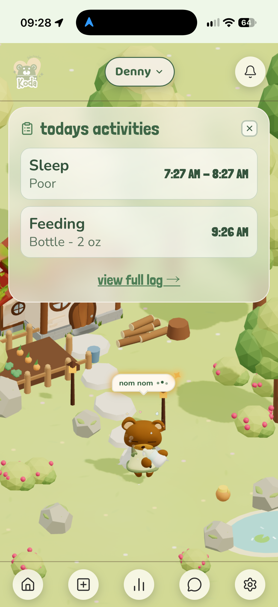

*Figure 4.2: Automated sync confirmation upon reconnecting to an internet network.*

---

### Feature 5: AI Anomaly Detection & Visual Trend Analytics
**Description:**  
Koda’s AI engine analyzes structured logging data over a minimum 7-day period to spot behavioral trends, routine changes, and health anomalies (such as sudden shifts in sleep duration or missed feeding schedules). The **Analytics Page** provides parents with graphical trend charts, milestone updates, status evaluations, and clear legal disclaimers that insights do not replace clinical medical advice.

**How to Use:**
1. Log activities consistently for at least 7 days to establish your child's baseline routine.
2. Tap the **Analytics (Chart)** icon on the bottom navigation bar (Parent access only).
3. Review the **Status Evaluation** card to see AI explanations for your child's current status animation (e.g., sleepy or hungry due to missed logs).
4. Examine weekly trend graphs for sleep cycles, feedings, and diaper history, along with AI-generated summary recommendations.

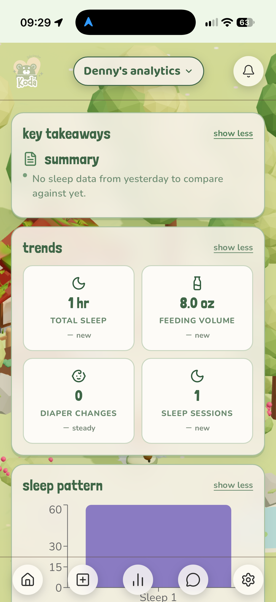

*Figure 5.1: Analytics dashboard displaying AI pattern anomaly analysis and trend summary.*

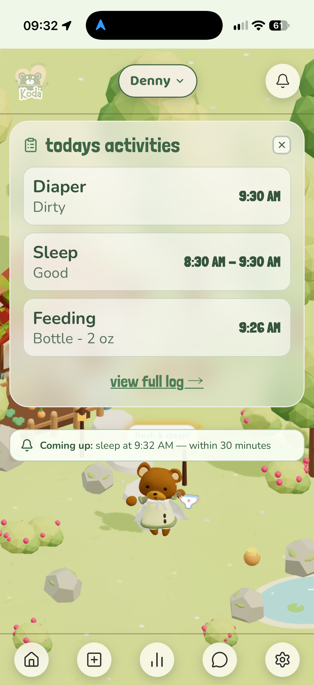

*Figure 5.2: Scheduled activity reminder, shown as related context for the activity data reviewed in analytics.*

---

### Feature 6: HIPAA-Compliant PDF Exporting
**Description:**  
Generates a secure, professionally formatted PDF report compiling raw activity logs, AI summaries, and visual trend charts Built to fulfill HIPAA technical safeguards (including client-side compilation in volatile memory and end-to-end data transmission security), these reports allow parents to share accurate health summaries with pediatricians.

**How to Use:**
1. Open the **Analytics Page** section from the dashboard.
2. Select the specific date range required for your medical visit (e.g., daily or weekly summary).
3. Tap the **Share/Export PDF** button at the bottom of the screen.
4. The application compiles an encrypted PDF containing raw logs and trend charts, which can be saved to your device or sent directly to your healthcare provider.

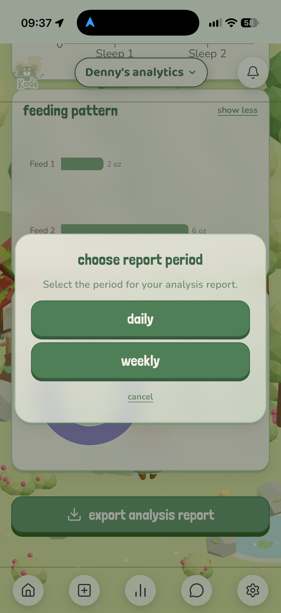

*Figure 6.1: Export configuration screen for selecting report date ranges and generating PDFs.*

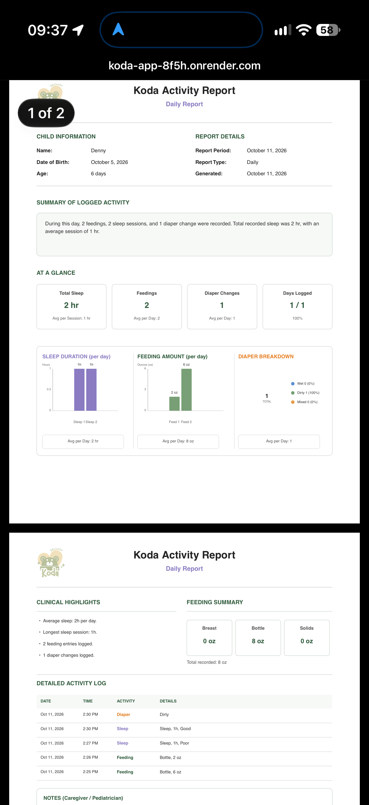

*Figure 6.2: Sample pediatrician-ready HIPAA PDF report containing raw activity logs and visual charts.*

---

### Feature 7: Multi-User Access Controls & In-App Messaging
**Description:**  
Primary Parent Admins have full access control to manage linked Caregivers. Parents can adjust permissions, toggle individual features (such as Chat Access or Logging Access), or revoke access entirely at any time. The feature also includes a secure, encrypted in-app messaging channel for direct communication between parents and active caregivers, complete with an **Emergency Alert** button to bypass silent notifications during urgent situations.

**How to Use:**
1. **Caregiver Permission Control:** Navigate to **Settings > Caregiver Settings** Toggle individual switches to grant or revoke **Chat Access** or **Logging Access**, or select **Delete User** to remove a caregiver.
2. **In-App Messaging:** Tap the **Chat** icon on the bottom navigation bar to open the private family messaging room.
3. **Emergency Alerts:** When sending an urgent message to a parent, tap the **Emergency Alert** button within the chat box to ensure the message triggers an immediate high-priority notification.

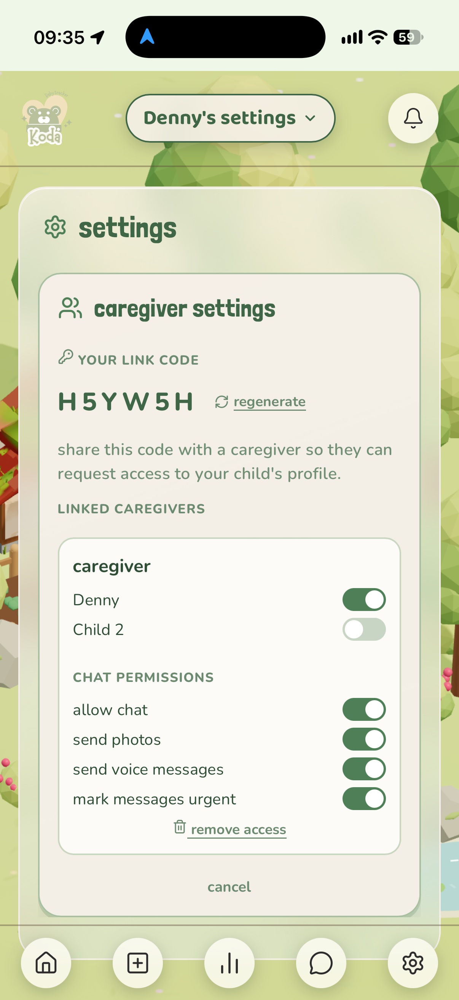

*Figure 7.1: Parent settings panel for toggling caregiver chat/logging permissions or revoking access.*

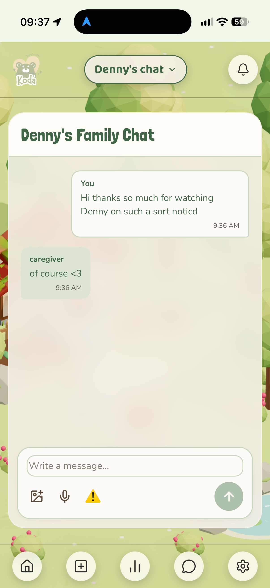

*Figure 7.2: In-app chat room interface featuring text messaging and emergency notification triggers.*

---

## 6. Troubleshooting Examples

| Problem | Cause | Solution |
| :--- | :--- | :--- |
| **Activity logs are not syncing between Parent and Caregiver** | Device is offline or experiencing unstable network connection. | Koda stores data locally while offline. Reconnect to Wi-Fi or cellular data; the Sync Manager will automatically merge saved logs. |
| **Caregiver cannot access child profile** | Caregiver account is unverified or the invite code has expired. | Ask the Primary Parent to navigate to **Settings > Caregiver Settings** to resend a valid invite code or check the access status. |
| **Duplicate entry warning appears for a valid separate log** | Two similar activities were recorded within the 15-minute safety window. | Tap **"Keep"** on the duplicate confirmation modal to force-save the second entry. |
| **Cannot view Analytics or Export PDF** | Account is signed in under a Caregiver role instead of Primary Parent Admin. | Log out and sign back in using the Primary Parent credentials. Caregiver accounts do not have permission to view full medical analytics or export reports. |

---

## 7. Contact Information
- **Support Email:** kodababytracker@gmail.com
- **Website:** https://koda-app-8f5h.onrender.com
- **Project Repository:** https://github.com/Team8-Bedrock/koda-babytracker
- **Other Support Channels:** TBD

---

## 8. FAQ

**Q: Is Koda safe to use offline during travel or outages?**  
**A:** Yes! Koda uses an offline-first architecture. You can log all baby activities without Wi-Fi or cellular service. All data is saved securely on your local device and will automatically sync to the cloud once a network connection is re-established.

**Q: Can I manage tracking for twins or multiple infants on one account?**  
**A:** Absolutely. Tap the child drop-down menu on the top header of your dashboard to switch between child profiles or create a new profile with its own unique avatar and logs.

**Q: Are the AI insights considered medical advice?**  
**A:** No. AI anomaly detection is designed strictly to help parents track behavioral trends and spot routine changes. Koda’s insights are not clinical advice. Always consult your pediatrician or healthcare professional for a proper medical evaluation.